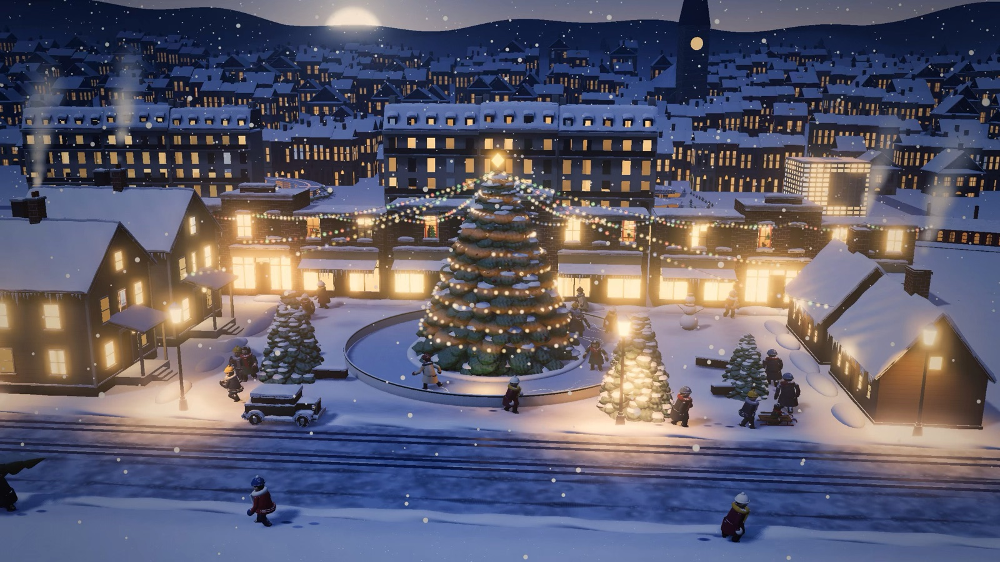

# ❄ Startup City Snow

A snowy 3D town as your Mac wallpaper. It snows, the lamps glow, people walk the street, cars drive past, and the
light follows your clock from dawn to late night.



## Install (one line)

1. Open **Terminal**: press ⌘ Space, type `Terminal`, press Return.
2. Paste this line and press Return:

```bash
curl -fsSL https://raw.githubusercontent.com/Herambchaudhari/startup-city-snow/main/install.sh | bash
```

3. Wait a few minutes for the download (about 190 MB). The town appears behind your desktop, and ❄ sits in the menu bar.

Click ❄ in the menu bar for the time of day, Pause, and **Start at login**. Snow also settles on top of your windows and desktop widgets and falls off when you move one; turn it off with
**Snow on windows** in the same menu.

**Needs:** a Mac with macOS 13 (Ventura) or newer. Apple Silicon or Intel.

## Columbia

Click ❄ → **Place** → **Columbia** for Columbia's campus instead of the town: all four seasons (it follows the date, or
pick one), clear or rainy days, falling leaves in fall, snow in winter, and the light following your clock. The first
time you open a part of the day, its film (about 23 MB) downloads in the background while a picture of it shows; after
that it plays straight away, even offline.

## Light on your Mac

The town is a pre-recorded film, played the way macOS plays its own moving wallpapers. It pauses when your windows
cover the screen, when the screen is locked or asleep, in Low Power Mode, and after 5 minutes without input.

## Uninstall

```bash
pkill -x StartupCitySnow; rm -rf "/Applications/Startup City Snow.app" ~/Applications/"Startup City Snow.app" ~/Library/LaunchAgents/com.startupcity.snow.plist ~/Library/Caches/com.startupcity.snow
```
